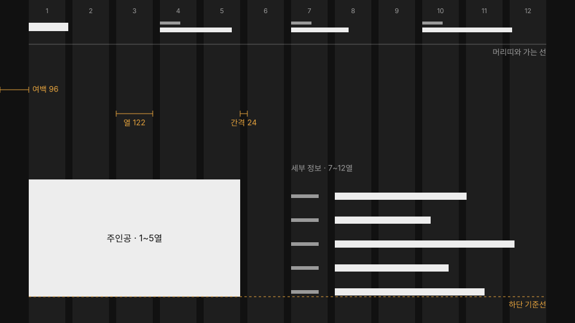
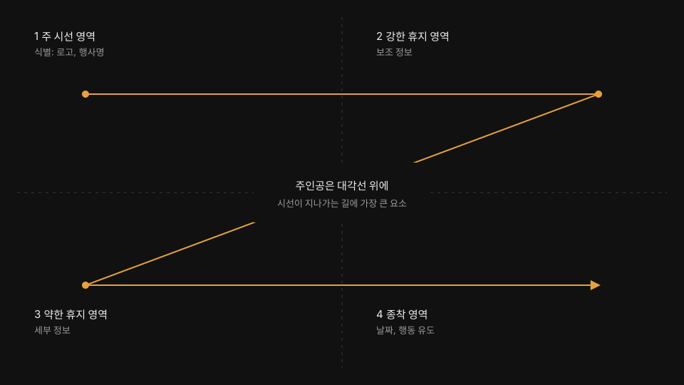
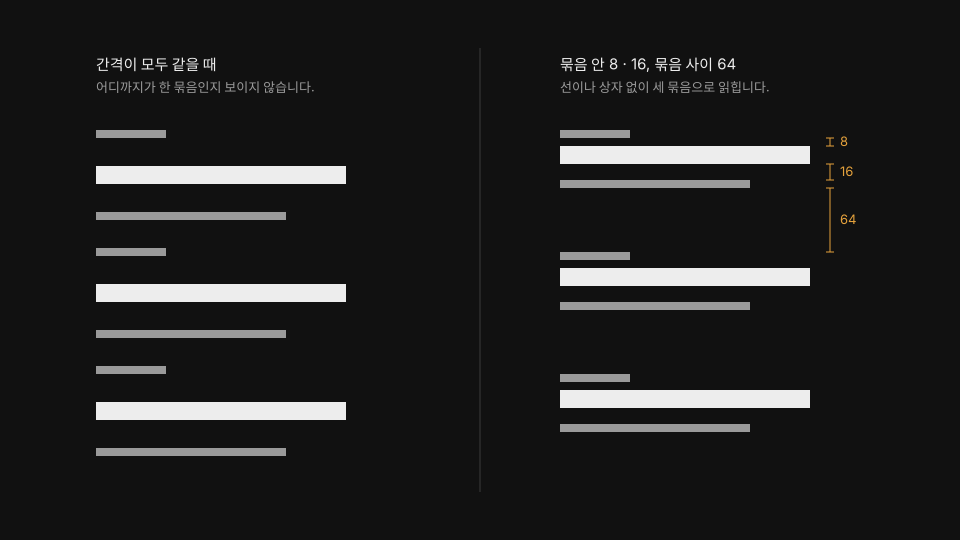

# 04. 레이아웃과 시선 흐름

배치의 목표는 두 가지입니다. 보는 사람의 눈이 의도한 순서로 움직이게 하는 것, 그리고 어떤 요소가 어떤 요소와 한 묶음인지 설명 없이 알게 하는 것입니다.

## 12단 그리드

요소의 가로 위치는 그리드의 열 시작선에서만 고릅니다. 스위스 스타일의 모듈 그리드에서 온 방법으로, 요제프 뮐러 브로크만의 『그래픽 디자인의 그리드 시스템』이 기준 문헌으로 꼽힙니다.

1920×1080 화면에서 쓴 수치입니다.

| 항목 | 값 | 비고 |
| --- | --- | --- |
| 좌우 여백 | 96 | 화면 폭의 5퍼센트 |
| 열 수 | 12 | 2, 3, 4, 6으로 나누어집니다 |
| 열 폭 | 122 | (1920 − 96×2 − 24×11) ÷ 12 |
| 열 사이 간격 | 24 | |
| i번째 열의 시작 x | 96 + 146 × i | i는 0부터 |
| 하단 기준선 | 화면 아래에서 88~96 | 본문 묶음의 아랫변이 닿는 선 |

자주 쓰는 분할입니다.

| 묶음 수 | 묶음당 열 | 시작 열 (0부터) |
| --- | --- | --- |
| 2 | 6 | 0, 6 |
| 3 | 4 | 0, 4, 8 |
| 4 | 3 | 0, 3, 6, 9 |
| 5:7 비대칭 | 5와 6, 한 열 비움 | 0, 6 |

다른 화면 크기에서는 여백을 폭의 5퍼센트 안팎으로 잡고 같은 식으로 열 폭을 구합니다.

## 시선 경로

글이 왼쪽에서 오른쪽으로 흐르는 문화권에서는 눈이 왼쪽 위에서 시작해 오른쪽 아래에서 끝난다고 설명하는 모델이 있습니다.

| 모델 | 내용 | 맞는 화면 |
| --- | --- | --- |
| 구텐베르크 다이어그램 | 화면을 네 영역으로 나눕니다. 왼쪽 위가 주 시선 영역, 오른쪽 아래가 종착 영역이고 나머지 두 곳은 덜 보입니다 | 요소가 고르게 퍼진 화면 |
| Z자 경로 | 왼쪽 위 → 오른쪽 위 → 왼쪽 아래 → 오른쪽 아래 | 포스터, 표지, 첫 화면 |
| F자 경로 | 위쪽을 가로로 훑고 왼쪽을 따라 내려갑니다 | 글이 많은 웹 문서. 포스터에는 덜 맞습니다 |

이 모델들을 그대로 믿으면 안 되는 이유가 두 가지 있습니다. 실증 근거가 약하다는 지적이 있고, 대비가 강한 요소 하나가 있으면 눈은 경로와 상관없이 그쪽으로 먼저 갑니다. 그래서 순서는 다음과 같이 씁니다.

1. 주인공의 크기와 대비로 첫 시선을 잡습니다.
2. 그다음에 읽을 요소들을 경로 위에 놓습니다.

실제 배치는 이렇게 했습니다.

| 영역 | 놓은 것 |
| --- | --- |
| 왼쪽 위 | 로고처럼 누구의 것인지 알려 주는 요소 |
| 위쪽 띠 | 행사명, 규모, 주최 같은 사실 정보 |
| 가운데에서 왼쪽 | 주인공 단어와 이미지 |
| 오른쪽 열 | 주제어, 한 줄 설명, 날짜 |
| 오른쪽 아래 | 마지막에 기억해야 할 것. 날짜나 다음 행동 |

## 머리띠와 가는 선

화면 위쪽에 얇은 정보 띠를 두면 식별 요소와 사실 정보를 한 번에 정리할 수 있습니다.

- 띠의 왼쪽 끝에 로고를 둡니다. 높이는 30 안팎입니다.
- 정보 칸은 열 시작선에 맞춥니다. 세 칸이면 3, 6, 9번 열에 둡니다.
- 각 칸은 작은 라벨과 값 두 줄로 씁니다.
- 띠 아래에 가는 선을 하나 긋습니다. 굵기 1, 흰색 30퍼센트 안팎입니다.
- 내지에서는 같은 자리에 로고와 쪽 번호를 두어 표지와 이어지게 합니다.

선은 이곳처럼 띠를 구분하거나 표의 행을 나눌 때만 씁니다. 나머지 구분은 간격으로 합니다.

## 하단 정렬

제목은 위에, 내용 묶음은 아래 기준선에 붙입니다. 제목과 내용 사이에 생기는 빈 공간이 화면의 숨 쉴 자리가 됩니다.

- 장마다 내용의 양이 달라도 아랫변이 같은 선에 닿으므로 넘겨 볼 때 흔들리지 않습니다.
- 큰 숫자나 큰 단어는 기준선에 잉크가 닿도록 맞춥니다.
- 내용이 적은 장은 위쪽이 더 비고, 그것이 정상입니다. 빈 곳을 채우려고 내용을 가운데로 올리지 않습니다.

## 근접성: 간격으로 묶기

가까이 있는 요소는 한 묶음으로 읽힙니다. 게슈탈트 원리 가운데 근접성은 색이나 모양의 유사성보다 강하게 작용한다고 정리되어 있습니다. 묶음을 만드는 첫 번째 도구가 간격인 이유입니다.

- 묶음 사이 간격은 묶음 안 간격의 두 배 이상으로 둡니다 (경험칙).
- 간격 값은 8의 배수 단계에서 고릅니다: 8, 16, 24, 32, 48, 64, 96. 값이 몇 개로 정해져 있으면 화면 전체의 리듬이 맞습니다.
- 묶음을 색 하나로만 구분하지 않습니다. 간격과 정렬을 함께 써야 색을 구분하기 어려운 사람에게도 읽힙니다.
- 정렬 없이 가깝기만 하면 어수선하고, 가깝지 않은데 정렬만 맞으면 관계가 보이지 않습니다. 둘을 함께 씁니다.

1920×1080 발표 자료에서 출발값으로 삼는 간격입니다. 위 단계에서 고른 값이며 내용에 따라 한 단계씩 조절합니다.

| 관계 | 간격 |
| --- | --- |
| 라벨과 값 | 8 |
| 값과 설명 | 16 |
| 표의 행과 행 | 24~32 |
| 묶음과 묶음 (세로) | 48~64 이상 |
| 제목 묶음과 내용 묶음 | 96 이상 |
| 열과 열 (가로) | 열 사이 간격 24. 더 벌릴 때는 빈 열을 둡니다 |

## 정렬 규칙

- 한 화면의 세로 시작선은 2~4개로 제한합니다.
- 줄들은 왼쪽 시작선을 공유합니다. 로고, 제목, 선, 날짜와 장소가 같은 x에서 시작하면 그것만으로 정돈되어 보입니다.
- 표는 라벨 열의 폭을 고정하고 값의 시작선을 하나로 맞춥니다.
- 쪽 번호처럼 오른쪽에 붙는 요소는 오른쪽 여백선에 끝을 맞춥니다.
- 큰 이름과 작은 부가 정보를 나란히 둘 때는 한 기준선 위에 올립니다. 장소 이름을 크게, 주소를 그 옆에 작게 두는 식입니다.

## 문장이 늘어날 때

기존 폭에 맞추려고 긴 줄만 축소하면 그 줄만 작아져 위계가 깨집니다. 문구가 바뀌면 묶음 전체의 크기와 줄바꿈을 다시 정합니다.

## 한 화면에 담는 양

- 한 화면은 한 가지 일을 합니다.
- 나열 항목이 여섯 개를 넘으면 묶음으로 나누거나 화면을 나눕니다. 일정표 가이드가 권하는 항목 수는 3~6개입니다 (경험칙).
- 화면을 줄여서 손톱만 한 크기로 봤을 때 주인공과 묶음의 수가 보이면 구조가 잡힌 것입니다.
