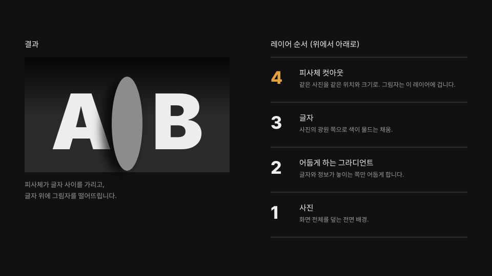

# 06. 사진과 깊이

사진은 화면에 깊이와 사실감을 주는 가장 빠른 재료입니다. 다만 넣는 방식에 따라 고급스럽게도, 오려 붙인 것처럼도 보입니다.

## 사진은 전면 배경으로 씁니다

사진을 창 모양이나 띠 모양으로 잘라 넣으면 두 가지 문제가 생깁니다. 사진이 잘려 보이고, 사진이 없는 나머지 영역이 따로 놀아 배경이 없는 화면처럼 보입니다. 실제로 창 모양 시안은 "잘린다", "배경이 있었으면 좋겠는데 왜 자르느냐"는 평을 받았습니다.

- 사진을 화면 전체에 깝니다. 화면보다 크게 놓아도 됩니다.
- 사진의 위치와 배율은 피사체가 구성상 필요한 자리에 오도록 정합니다. 화면 밖으로 나가는 부분은 버립니다.
- 글자는 사진 위에 얹거나 피사체 뒤에 둡니다.

한 사례에서는 3240×1350 사진을 1920×1080 화면에 4581×1909 크기로 놓았습니다. 화면보다 2.4배 넓게 놓고 왼쪽 위로 밀어서, 피사체가 주인공 단어의 글자 사이에 오게 했습니다. 원본보다 1.4배 확대한 셈이므로 이 정도가 선명도의 한계였습니다.

## 사진 고르기

| 확인할 것 | 이유 |
| --- | --- |
| 피사체가 하나이고 윤곽이 분명한가 | 글자와 겹칠 때 형태가 읽혀야 합니다 |
| 글자를 놓을 조용한 영역이 있는가 | 어둡거나 고른 면이 있어야 글자가 읽힙니다 |
| 광원의 방향을 알 수 있는가 | 글자의 빛과 그림자 방향을 여기에 맞춥니다 |
| 해상도가 출력 크기를 감당하는가 | 확대 배율이 1.5배를 넘으면 흐려지기 시작합니다 (경험칙) |
| 사용 권리를 확인했는가 | 공개 자료에 쓰려면 출처와 사용 조건을 확인합니다 |

컨셉에서 직접 나온 사물 하나가 찍힌 사진이 가장 좋습니다 ([07](07-concept.md)). 흑백 단체 사진이나 분위기만 있는 스톡 사진은 쓰지 않습니다.

## 글자를 피사체 뒤에 두기

주인공 단어를 사진 위에 얹기만 하면 사진과 글자가 따로 있습니다. 피사체가 글자 일부를 가리게 하면 글자가 사진 속 공간에 들어간 것처럼 보입니다. 잡지 표지와 포스터에서 흔히 쓰는 방법입니다.

레이어는 아래에서 위로 이 순서입니다.

1. 사진. 화면 전체를 덮습니다.
2. 어둡게 하는 층. 글자와 정보가 놓이는 쪽만 덮습니다.
3. 글자.
4. 피사체 컷아웃. 1번과 같은 사진에서 피사체만 남기고 투명하게 만든 것입니다.

4번은 1번과 위치, 크기, 채움 방식이 완전히 같아야 합니다. 한 픽셀이라도 어긋나면 피사체 가장자리에 이중 윤곽이 생깁니다. 사진을 담은 사각형을 복제해 이미지만 컷아웃으로 바꾸는 방식이 안전합니다.

### 단어가 읽혀야 합니다

- 피사체는 글자와 글자 사이를 지나가거나, 글자 하나의 일부만 가리게 둡니다.
- 피사체가 글자 하나의 자리를 통째로 차지하는 구성도 가능합니다. 이때는 피사체의 형태가 그 글자를 대신해야 하고, 처음 보는 사람이 단어를 바로 읽는지 확인합니다.
- 글자색은 피사체가 아니라 글자 뒤 배경과 대비되게 고릅니다. 피사체와 같은 색이면 경계가 사라집니다.

### 그림자

컷아웃 레이어에 그림자를 걸면 피사체가 글자보다 앞에 있다는 것이 분명해집니다.

| 항목 | 1920×1080에서 쓴 값 | 기준 |
| --- | --- | --- |
| 방향 | x −14, y +10 | 사진 속 광원의 반대쪽 |
| 흐림 | 48 | 넓고 부드럽게. 윤곽이 보이면 오려 붙인 티가 납니다 |
| 불투명도 | 55퍼센트 | 글자 위에서 보일 만큼만 |

### 글자에 빛 입히기

사진 속에 광원이 있으면 글자도 그 빛을 받아야 같은 공간에 있는 것으로 보입니다.

- 글자 채움을 그라디언트로 두고, 광원에서 먼 쪽은 흰색, 광원 쪽 끝은 강조색으로 둡니다.
- 색이 바뀌는 구간은 광원에 가까운 절반 안에 둡니다. 글자 전체가 물들면 장식 그라디언트로 읽힙니다.
- 발광 효과나 외곽선은 더하지 않습니다.

### 가장자리

- 컷아웃 가장자리에 배경색이 얇게 남으면 합성이 바로 드러납니다. 사진에 없는 색 위에 얹어 보면 남은 테두리가 보입니다.
- 가장자리는 1픽셀 안팎으로 부드럽게 합니다.
- 연기, 머리카락, 빛 번짐처럼 반투명한 부분은 밝기에 비례한 반투명으로 남깁니다. 딱 자르면 종이를 오린 것처럼 보입니다.

## 포토샵 없이 컷아웃 만들기

피사체가 배경보다 확실히 밝은 사진이라면 밝기와 연결 영역만으로 분리할 수 있습니다. [tools/cutout.py](../tools/README.md)가 이 방법을 씁니다.

1. 픽셀 밝기를 R, G, B 중 최댓값으로 구합니다.
2. 임계값으로 밝은 곳과 어두운 곳을 나눕니다.
3. 화면 가장자리에서 이어진 어두운 영역을 배경으로 표시합니다.
4. 피사체 위에 찍은 점에서 이어진 밝은 영역을 피사체로 표시합니다. 떨어져 있는 밝은 조각은 여기서 빠집니다.
5. 피사체에 붙어 있으면서 배경과 이어지지 않은 어두운 부분을 피사체에 넣습니다.
6. 피사체 가장자리 근처에서만 밝기에 비례한 반투명을 허용합니다.
7. 알파를 약하게 흐립니다.

거친 임계값 하나로 자르면 배경의 밝은 점까지 딸려 옵니다. 4번의 연결 영역 단계가 이것을 걸러 냅니다.

피사체 자동 선택 기능이 있는 편집 도구를 쓸 수 있으면 그쪽이 빠릅니다. 어느 방법이든 결과는 같은 기준으로 확인합니다. 사진에 없는 색 위에 얹어 테두리를 보고, 실제 구성에 넣어 100퍼센트 크기로 가장자리를 봅니다.

## 내지에서 사진 쓰기

- 내지 배경은 표지와 같은 사진의 조용한 부분이나 같은 계열의 사진을 씁니다. 장마다 다른 사진을 쓰면 한 벌로 보이지 않습니다.
- 글이 있는 장은 어둡게 하는 층을 표지보다 진하게 둡니다.
- 마지막 장에 표지의 사진을 다시 쓰면 처음과 끝이 이어집니다.
